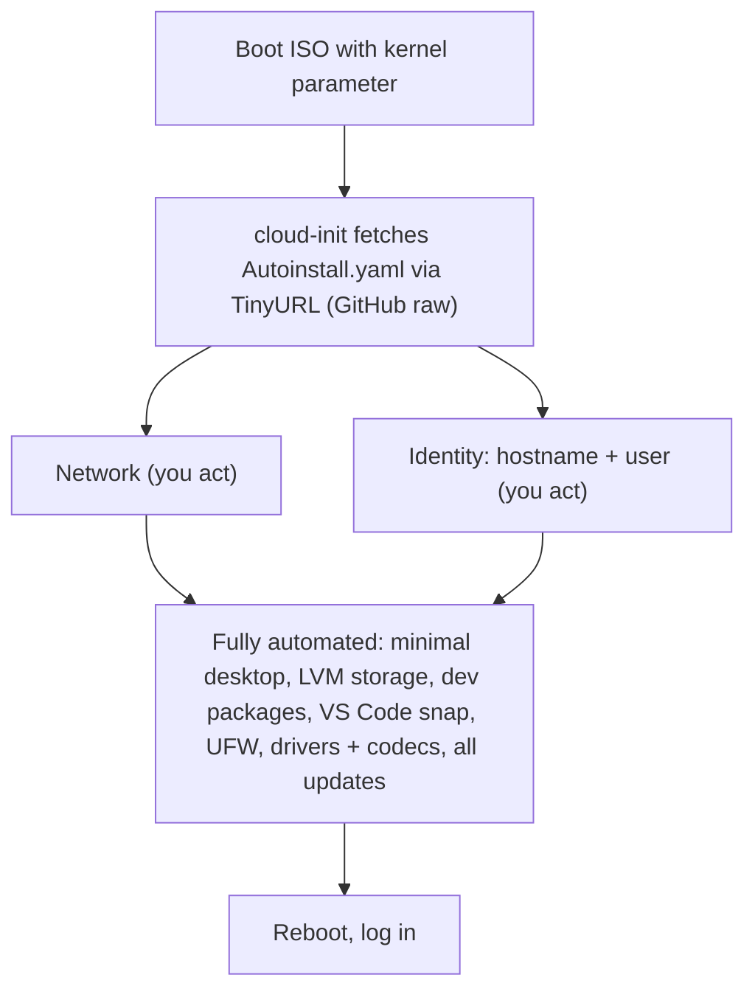
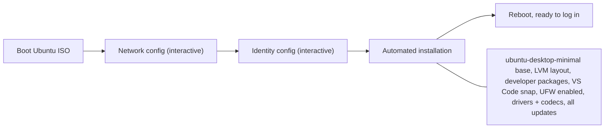

# Autoinstall YAML

Reproducible, spec-driven **Ubuntu autoinstall configurations** for developer workstations.

https://tinyurl.com/jvh-autoinstall

This repository contains a version-controlled [Ubuntu Autoinstall](https://canonical-subiquity.readthedocs-hosted.com/en/latest/reference/autoinstall-reference.html) (subiquity) YAML file that provisions a developer workstation consistently and without manual intervention — except for the two things that must be per-machine: **network configuration** and **user identity**.

Target release is **Ubuntu 26.04 LTS (Resolute Raccoon)**; 24.04 LTS remains the minimum. The reference machine is a Dell Latitude 5400 running 26.04.1 LTS.

> [!IMPORTANT]
> As of 2026-11-16 no install has been verified end to end from this file. The `#cloud-config` header required for the deploy path below was only added in FEAT-0008; see [docs/ROADMAP.md](docs/ROADMAP.md) for the grounded status.

Changes to the configuration are governed by a **spec-based development workflow**: every modification starts with a formal feature specification that must be reviewed and approved before it is implemented.

---

## Quick Deploy

1. Boot the Ubuntu Desktop ISO.
2. Press `e` to edit the GRUB entry.
3. Find the line starting with `linux` and append to the end of it:

```text
autoinstall cloud-config-url=https://tinyurl.com/jvh-autoinstall
```

4. Press `F10` to boot.

> [!NOTE]
> The installer fetches the config from the TinyURL above, pauses for **network** and **identity**, then runs completely unattended until reboot.

---

### One-time URL setup

The short URL points to the raw `Autoinstall.yaml` file in this repository. Create it once on [tinyurl.com](https://tinyurl.com) — it never expires:

| Step | Action |
|------|--------|
| 1 | Go to **[tinyurl.com](https://tinyurl.com)** |
| 2 | Paste the long URL: `https://raw.githubusercontent.com/jvanheerikhuize/Autoinstall-YAML/main/Autoinstall.yaml` |
| 3 | Set a custom alias (e.g. `jvh-autoinstall`) |
| 4 | Click **Make TinyURL** |
| 5 | ✓ Done — alias is `jvh-autoinstall` |

> [!TIP]
> TinyURL custom links are free, require no account, and never expire. Use something memorable — you'll type or paste this at the boot prompt.

---

### What happens after you boot



---

## How It Works



The file starts with `#cloud-config` and a single top-level `autoinstall:` key. Both are required because the kernel parameter hands the file to cloud-init first, which only accepts payloads that begin with that header.

---

## Repository Structure

```text
├── Autoinstall.yaml                # Active configuration — also served via TinyURL for quick deploy
│
├── specs/
│   ├── features/
│   │   ├── FEAT-0001-ubuntu-developer-workstation.yaml  # implemented — base workstation config
│   │   ├── FEAT-0004-automated-locale-timezone.yaml     # implemented — locale/keyboard/timezone
│   │   ├── FEAT-0005-openscad-environment.yaml          # draft — OpenSCAD (premise outdated)
│   │   ├── FEAT-0006-esp32-development-environment.yaml # draft — ESP32 toolchain
│   │   ├── FEAT-0007-dotfiles-provisioning.yaml         # draft — dotfiles clone at install time
│   │   ├── FEAT-0008-cloud-init-delivery.yaml           # review — #cloud-config header + verified install
│   │   └── _template.yaml                               # Template for new specs
│   └── schemas/
│       └── feature-spec.schema.json                     # Spec validation schema
│
├── specs.config.yaml               # Central spec registry
│
├── .ai/                            # AI assistant context
│   ├── CONTEXT.md                  # Project context (AI starts here)
│   ├── config.yaml                 # AI behavior configuration
│   ├── specs/SPEC.md               # Product specification
│   └── architecture/
│       ├── ARCHITECTURE.md         # How the autoinstall system is structured
│       └── PATTERNS.md             # YAML conventions
│
├── .claude/
│   └── CLAUDE.md                   # Claude Code instructions
│
├── docs/
│   ├── ROADMAP.md                  # Grounded findings, status and phased plan
│   ├── spec-based-development.md   # Spec workflow guide
│   └── runbooks/                   # Operational procedures
│
└── scripts/
    ├── validate-specs.sh           # Local schema + lint check (python3, no npm needed)
    ├── ingest-spec.sh              # Bash: process a spec with an AI CLI
    └── Invoke-SpecIngestion.ps1    # PowerShell: same, for Windows
```

---

## Current Status

| Spec | Title | Status |
|------|-------|--------|
| [FEAT-0001](specs/features/FEAT-0001-ubuntu-developer-workstation.yaml) | Ubuntu Developer Workstation Autoinstall | implemented |
| [FEAT-0004](specs/features/FEAT-0004-automated-locale-timezone.yaml) | Automated Locale, Keyboard, and Timezone | implemented |
| [FEAT-0005](specs/features/FEAT-0005-openscad-environment.yaml) | OpenSCAD 3D Modeling Environment | draft |
| [FEAT-0006](specs/features/FEAT-0006-esp32-development-environment.yaml) | ESP32 Embedded Development Environment | draft |
| [FEAT-0007](specs/features/FEAT-0007-dotfiles-provisioning.yaml) | Dotfiles Provisioning | draft |
| [FEAT-0008](specs/features/FEAT-0008-cloud-init-delivery.yaml) | Deployable via cloud-init and verified end to end | review |

> `Autoinstall.yaml` implements FEAT-0001 and FEAT-0004 and carries the FEAT-0008 header. It has not yet completed a verified install (FEAT-0008 AC-002).

---

## Spec-Based Workflow

All changes to the autoinstall configuration follow this process:

```
1. Draft a spec in specs/features/FEAT-XXXX-<name>.yaml
2. Submit for review → set status: review
3. Approve → set status: approved
4. Implement → create/update Autoinstall.yaml
5. Test in a VM
6. Merge → set status: implemented
```

### Creating a New Spec

Copy the template and fill in the required fields:

```bash
cp specs/features/_template.yaml specs/features/FEAT-0002-my-feature.yaml
```

Required fields: `metadata.id`, `metadata.title`, `metadata.version`, `metadata.status`, `description.summary`, `description.problem_statement`, `description.proposed_solution`, and at least one entry in `acceptance_criteria`.

Validate locally before pushing (needs only `python3`, PyYAML and `jsonschema`):

```bash
scripts/validate-specs.sh
```

### Implementing a Spec (AI-assisted)

```bash
# Bash/Unix — process an approved spec with AI
./scripts/ingest-spec.sh specs/features/FEAT-0001-ubuntu-developer-workstation.yaml

# PowerShell — same, for Windows
./scripts/Invoke-SpecIngestion.ps1 -SpecFile specs/features/FEAT-0001-ubuntu-developer-workstation.yaml
```

---

## Testing the Autoinstall YAML

The recommended way to test is to boot the Ubuntu Desktop 26.04 LTS ISO in a VirtualBox VM (at least 25 GB disk, 4 GB RAM) and use the TinyURL kernel parameter from the Quick Deploy section above. VirtualBox is the hypervisor available on the reference machine; QEMU and multipass are not installed.

```bash
# Alternative: serve the YAML over HTTP (file must still start with #cloud-config) and boot with:
#   autoinstall ds=nocloud-net;s=http://<your-ip>/
```

After installation, verify:
- All packages in the spec are present
- Snaps are installed (`snap list`)
- UFW is active (`sudo ufw status`)
- User account exists with sudo
- Machine was configured with LVM (`sudo vgs`)

---

## AI Assistant Setup

This repository is configured for AI-assisted development. Any AI coding assistant can use the context in `.ai/`:

| File | Purpose |
|------|---------|
| [.ai/CONTEXT.md](.ai/CONTEXT.md) | Project overview — AI reads this first |
| [.ai/specs/SPEC.md](.ai/specs/SPEC.md) | Product specification |
| [.ai/architecture/ARCHITECTURE.md](.ai/architecture/ARCHITECTURE.md) | How the autoinstall system is structured |
| [.ai/architecture/PATTERNS.md](.ai/architecture/PATTERNS.md) | YAML conventions |
| [.ai/config.yaml](.ai/config.yaml) | AI behavior preferences |

Claude Code users: the `.claude/CLAUDE.md` file is auto-loaded and instructs Claude to read these context files first.

---

## Author

**Jerry van Heerikhuize** ([@jvanheerikhuize](https://github.com/jvanheerikhuize))

---

## References

- [Ubuntu Autoinstall Reference](https://canonical-subiquity.readthedocs-hosted.com/en/latest/reference/autoinstall-reference.html)
- [Ubuntu Autoinstall Quick Start](https://canonical-subiquity.readthedocs-hosted.com/en/latest/howto/autoinstall-quickstart.html)
- [cloud-init and autoinstall interaction](https://canonical-subiquity.readthedocs-hosted.com/en/latest/explanation/cloudinit-autoinstall-interaction.html)
- [cloud-init kernel command line (`cloud-config-url`)](https://docs.cloud-init.io/en/latest/explanation/kernel-command-line.html)
- [Subiquity on GitHub](https://github.com/canonical/subiquity)

## Roadmap

See [docs/ROADMAP.md](docs/ROADMAP.md): grounded findings (2026-07-24), re-grounded status (2026-11-16) and the phased plan.

---
