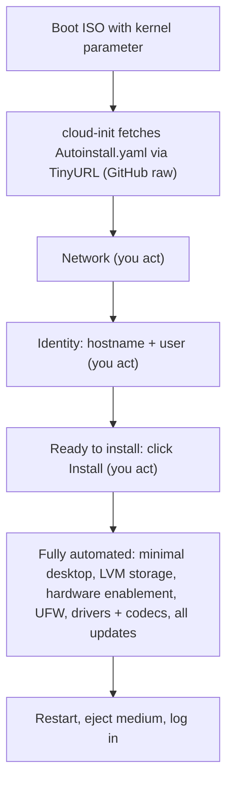

# Autoinstall YAML

One [Ubuntu Autoinstall](https://canonical-subiquity.readthedocs-hosted.com/en/latest/reference/autoinstall-reference.html) file that installs a developer laptop unattended, except for the two things that are per machine: **network** and **identity**. The point is that a fresh machine can be rebuilt from a URL without documentation lookup or manual tweaking.

Short URL for the boot prompt: https://tinyurl.com/jvh-autoinstall

Target release is **Ubuntu 26.04 LTS (Resolute Raccoon)**; 24.04 LTS is the minimum. Reference machine: Dell Latitude 5400.

> [!NOTE]
> Verified end to end on 2026-11-16 with Ubuntu 26.04.1 Desktop in VirtualBox. See [Verification record](#verification-record).

This is **stage 1** of a three-stage machine rebuild. Stage 2 is [dotfiles](https://github.com/jvanheerikhuize/dotfiles) (apps and configuration), stage 3 is [agentic-workspace](https://github.com/jvanheerikhuize/agentic-workspace) (agent tooling). The split, the decisions, the open work and the rebuild runbook are in [PLAN.md](PLAN.md).

## Quick Deploy

1. Boot the Ubuntu Desktop ISO.
2. Press `e` to edit the GRUB entry.
3. Find the line starting with `linux` and append to the end of it:

```text
autoinstall cloud-config-url=https://tinyurl.com/jvh-autoinstall
```

4. Press `F10` to boot.



The file starts with `#cloud-config` and a single top-level `autoinstall:` key. Both are required because the kernel parameter hands the file to cloud-init first, which only accepts payloads that begin with that header.

The short URL points to the raw `Autoinstall.yaml` on `main`. If it ever has to be recreated: on [tinyurl.com](https://tinyurl.com), paste `https://raw.githubusercontent.com/jvanheerikhuize/Autoinstall-YAML/main/Autoinstall.yaml` and set the alias `jvh-autoinstall`.

## What stage 1 owns

Only what must exist before first login:

1. `ubuntu-desktop-minimal` base, LVM layout, all updates, drivers and codecs
2. Latitude 5400 hardware enablement: `intel-microcode`, `thermald`, `alsa-ucm-conf`, `bolt`, `fwupd-signed`
3. UFW enabled, Ubuntu's security snaps (`prompting-client`, `desktop-security-center`)
4. `git`, `gh`, `curl`, `wget`, `build-essential` so stage 2 can be fetched and GitHub auth works on first login

Editors, runtimes and GUI apps belong to stage 2: `nodejs`, `npm`, VS Code and `gufw` are installed by the dotfiles profiles, not here.

## Files

```text
├── Autoinstall.yaml    # The product; served via TinyURL
├── PLAN.md             # Three-stage rebuild: ownership, decisions, work items, runbook
└── .github/workflows/validate-autoinstall.yml   # CI: header and top-level key check
```

## Changing the file

Open a pull request. CI checks that the file starts with `#cloud-config` and parses with a single top-level `autoinstall` key. Test in a VM before merging anything that changes what gets installed: boot the Ubuntu Desktop 26.04 LTS ISO in VirtualBox (at least 25 GB disk, 4 GB RAM) with the Quick Deploy kernel parameter, then run the checklist from the verification record below and update that record.

To test a local copy instead of the TinyURL, serve the directory over HTTP (the file must still start with `#cloud-config`) and boot with `autoinstall ds=nocloud-net;s=http://<your-ip>/`.

## Verification record

Last verified run: **2026-11-17** (full re-run on a fresh disk; first run 2026-11-16), Ubuntu 26.04.1 LTS Desktop ISO, VirtualBox 7.2 (Ubuntu archive build), 4 GB RAM, 30 GB disk, NAT network, file fetched through the TinyURL. The `gh` package was added after this run.

| Check | Result |
| :--- | :--- |
| cloud-init fetched the file and the installer skipped language, keyboard, layout, storage and app screens | pass |
| Screens that still asked for input | Internet connection, Create your account, Ready to install |
| All 13 `packages` entries installed (`dpkg -s`) | pass |
| Snaps `prompting-client`, `desktop-security-center` present (`snap list`) | pass |
| `ufw status` is active (late command) | pass |
| User is in `sudo`; `sudo vgs` shows `ubuntu-vg` | pass |
| Root volume uses the whole volume group (`sudo vgs` shows 0 free) | pass on 2026-11-17 (26.95 GB); failed on 2026-11-16 before `sizing-policy: all` |
| Timezone Europe/Amsterdam, locale en_US.UTF-8, keyboard us | pass |
| All updates applied (`apt list --upgradable` empty after first boot) | pass |
| Restart ejects the medium and boots the installed system | pass, after the guest asks to remove the medium and press Enter |

Findings from these runs:

1. Without `sizing-policy: all` the `lvm` layout sized the root volume to half the disk (13.5 of 26.9 GB). With it, the 2026-11-17 re-run gave root the full 26.95 GB.
2. "Ready to install" is always shown when any section is interactive, so a rebuild needs three clicks, not two.
3. The installer's own log of the run is kept in the installed system under `/var/log/installer/`.

Checklist for the next run, from a terminal in the installed system:

```bash
for p in git gh curl wget build-essential ca-certificates gnupg intel-microcode thermald alsa-ucm-conf bolt fwupd-signed; do dpkg -s "$p" >/dev/null 2>&1 && echo "OK $p" || echo "MISSING $p"; done
snap list | awk 'NR>1{print $1}'
id -nG | tr ' ' '\n' | grep -x sudo
sudo ufw status | head -1
sudo vgs; sudo lvs; df -h /
apt list --upgradable 2>/dev/null
```

## References

1. [Ubuntu Autoinstall Reference](https://canonical-subiquity.readthedocs-hosted.com/en/latest/reference/autoinstall-reference.html)
2. [cloud-init and autoinstall interaction](https://canonical-subiquity.readthedocs-hosted.com/en/latest/explanation/cloudinit-autoinstall-interaction.html)
3. [cloud-init kernel command line (`cloud-config-url`)](https://docs.cloud-init.io/en/latest/explanation/kernel-command-line.html)
