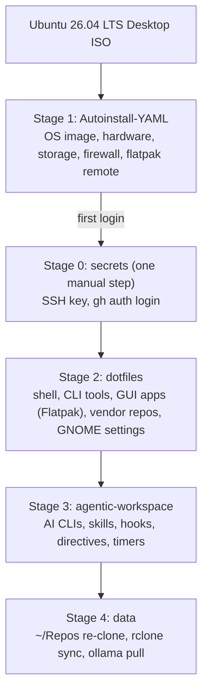

# Stateless Laptop Plan

> Written 2026-11-16 from a scan of the reference machine (Dell Latitude 5400, Ubuntu 26.04.1 LTS)
> and the three repositories involved. Decisions in §2 were made by the owner on the same day.
> Goal: a clean machine is installed and fully usable with one boot parameter, two clones and one
> secrets step. Nothing on the laptop is precious; everything precious has a home elsewhere.

---

## 1. Target shape

Four stages, each owned by exactly one repository, plus a data layer that is never on the laptop only.

### Ownership rule (the ADR the roadmap asked for)

| Stage | Owns | Does not own |
|-------|------|--------------|
| 1 Autoinstall-YAML | What must exist before first login: base image, kernel/firmware/hardware enablement, storage layout, UFW, `git`/`curl`/`gh`, `flatpak` + Flathub remote, Ubuntu's own security snaps | Editors, runtimes, GUI apps, shell config |
| 2 dotfiles | Everything a user sees: bash + starship, CLI tools, Flatpak apps, the few vendor apt repos, GNOME/dconf settings, fonts | Agent tooling, hardware |
| 3 agentic-workspace | AI CLIs (`claude`, `gemini-cli`, `agy`, `kimi`), `~/.agents`, hooks, directives, systemd user timers, `ollama` and its model list | Anything a non-agent user needs |
| 4 data | A list of repos to clone, rclone remotes, folders that sync | Anything that is only on this disk |

Rule of thumb: if a package appears in two stages, the lower stage drops it. Today `nodejs`, `npm`
and the `code` snap are in both stage 1 and stage 2; they move to stage 2 only.

---

## 2. Decisions (owner, 2026-11-16)

| # | Decision | Choice | Consequence |
|---|----------|--------|-------------|
| D1 | Base OS | **Ubuntu 26.04 LTS**, autoinstall | Stage 1 stays as is; see §6 for the distribution comparison |
| D2 | Shell | **bash + starship** | dotfiles keeps `.bashrc`, `.bash_aliases`, `.bash_profile`; the orphaned `~/.zshrc` and `~/.config/fish` are dropped; starship installed from its release binary, not cargo |
| D3 | GUI packaging | **Flatpak-first** | Stage 1 installs `flatpak` and adds Flathub; stage 2 lists Flatpak IDs; snaps shrink to Ubuntu's own (Firefox, security center, firmware updater); vendor apt repos kept only where Flatpak is wrong (VS Code, VirtualBox) |
| D4 | Personal state | **Git-first + one secrets step** | Rebuild = restore one SSH key, `gh auth login`, clone list, rclone sync, `ollama pull` list; no disk image backup |

Open owner decision: full-disk encryption. A laptop without LUKS is the single biggest risk in this
design. Adding `storage` to `interactive-sections` costs one prompt per install and keeps the
no-secrets rule. Recommended: yes.

---

## 3. Current state, classified

Scan of 2026-11-16. Each item gets a destination: **S1** stage 1, **S2** stage 2, **S3** stage 3,
**S4** data, **drop**. Only packages marked manual in apt, snaps, flatpaks and user-level tools are
listed; dependencies are not.

### 3.1 Stage 1 (stays in Autoinstall.yaml)

| Item | Note |
|------|------|
| `ubuntu-desktop-minimal`, `ubuntu-restricted-addons` (via `codecs`) | base |
| `intel-microcode`, `thermald`, `alsa-ucm-conf`, `bolt`, `fwupd-signed`, `linux-generic` | Latitude 5400 enablement |
| `git`, `curl`, `wget`, `ca-certificates`, `gnupg`, `build-essential` | needed to fetch stage 2 |
| `gh` | **add**: stage 0 needs it on first login; it is in the 26.04 archive |
| `flatpak` + Flathub remote | **add** (D3): one `late-command` adds the remote system-wide |
| UFW enable, `prompting-client`, `desktop-security-center` snaps | security defaults |
| `efibootmgr`, `grub-efi-amd64-signed`, `shim-signed` | installer owned |

Leaves stage 1: `nodejs`, `npm`, `code` snap, `gufw` (GUI, S2).

### 3.2 Stage 2 (dotfiles, profile `dev` extends `desktop` extends `base`)

CLI (apt unless noted):

| Item | Note |
|------|------|
| `bat`, `fd-find`, `fzf`, `zoxide`, `ripgrep`, `eza`, `duf`, `ncdu`, `jq`, `tree`, `xclip` | `ripgrep` and `eza` from apt, not cargo |
| `starship` | release binary via its install script, pinned version |
| `shellcheck`, `nmap`, `tshark`, `nvme-cli`, `smartmontools`, `lm-sensors`, `powertop`, `mesa-utils`, `vainfo` | diagnostics |
| `rclone`, `rsync`, `zip`, `unzip` | S4 depends on `rclone` |
| `ffmpeg`, `handbrake-cli` | media CLI |
| `adb`, `fastboot`, `libusb-1.0-0-dev`, `libsdl2-dev`, `pkg-config` | hardware repos (usb-*, numworks) |
| `rustup`, `go` (tarball to `~/.local`), `uv` (installer), `nodejs` 22 from Ubuntu archive | toolchains; `pipx` dropped in favour of `uv tool` |
| `python3-pip`, `python3-venv`, `python3-dev` | |
| `php-cli`, `php-gd` | keep only if still used; flag |
| `alacritty` | apt (in 26.04), replaces the classic snap |
| `fonts-firacode` + Nerd Font for starship | fonts into `~/.local/share/fonts` |
| `gnome-tweaks`, `dconf-editor`, `gparted`, `pavucontrol`, `gnome-shell-extension-manager` | GNOME |
| dconf dump of `/org/gnome/` (dock, tiling-assistant, keybindings, dark mode) | **add**: `dotfiles/dconf.ini` loaded on install |
| `~/.config/alacritty`, `~/.config/git`, `~/.gitconfig`, `~/.config/starship.toml` | dotfiles proper |

GUI as Flatpak (Flathub IDs):

| Today | Flatpak |
|-------|---------|
| `google-chrome-stable` (deb, vendor repo) | `com.google.Chrome` |
| `signal-desktop` (deb, vendor repo) | `org.signal.Signal` |
| `vlc` (deb) and `vlc` snap | `org.videolan.VLC` |
| `inkscape`, `krita`, `libreoffice`, `spotify`, `gitkraken`, `transmission`, `mailspring`, `cheese` snaps | `org.inkscape.Inkscape`, `org.kde.krita`, `org.libreoffice.LibreOffice`, `com.spotify.Client`, `com.axosoft.GitKraken`, `com.transmissionbt.Transmission`, `com.getmailspring.Mailspring`, `org.gnome.Cheese` |
| `filezilla` (deb) | `org.filezillaproject.Filezilla` |
| `rpi-imager` (deb) | `org.raspberrypi.rpi-imager` |
| OrcaSlicer, HandBrake | already Flatpak |
| ElegooSlicer AppImage in `~/.local/bin` | keep as `custom` entry with a pinned URL, or drop |
| `realvnc-vnc-viewer`, `gftp`, `curlftpfs`, `innoextract`, `coder`, `goose` | **drop** unless still used |

Stay as vendor apt repos (Flatpak is the wrong fit):

| Item | Why |
|------|-----|
| `code` (Microsoft repo) | needs host toolchains; the Flatpak sandbox fights that daily |
| `virtualbox-7.2` (Oracle repo or Ubuntu archive) | kernel modules |
| Firefox | Ubuntu's snap is fine; leave it |

### 3.3 Stage 3 (agentic-workspace)

Already in `install.sh`: `~/.agents`, `~/AGENTS.md`, `~/CLAUDE.md`, `~/GEMINI.md`, `~/.claude/settings.json`,
Gemini config, git ignore, `workspace-audit.timer`.

**Add** to `install.sh` (idempotent, check-before-install):

| Item | Source today |
|------|--------------|
| `claude` | native installer into `~/.local/bin` |
| `gemini-cli` | snap (`pfsmorigo`), or npm; pick one |
| `agy`, `kimi`, `twin`, `ask`, `agent` | `~/.local/bin`; record the installer for each |
| `ollama` | official install script, `ollama.service` user unit |
| ollama models: `qwen3.5:9b`, `qwen3.5:4b`, `granite4:tiny-h` | `models.txt` + `ollama pull` loop |
| `gitleaks`, `semgrep`, `trivy`, `mkdocs`, `httpx` | currently loose in `~/.local/bin`; move to `uv tool` / release binaries listed in the repo |
| `twin-collect.timer` | from `digital-twin`; that repo owns it, agentic-workspace only enables it if present |

### 3.4 Stage 4 (data)

| Data | Home | Rebuild action |
|------|------|----------------|
| `~/.ssh/id_ed25519` | password manager or an offline USB | stage 0: restore, `chmod 600`, `ssh -T git@github.com` |
| GitHub auth | `gh auth login` | stage 0 |
| `~/Repos` (26 directories, 4 without a remote) | GitHub | `gh repo list jvanheerikhuize --limit 200` or a committed `repos.txt`; `git clone` loop. The 4 directories without a remote (`asdlc`, `website`, `tinydesktopgame`, `makersbordjes`, see `~/ROADMAP.md`) must get a remote or be declared disposable |
| `~/Documents`, `~/Pictures` | Google Drive via `rclone` | `rclone bisync`; the `fluhus/gnome-googledrive` PPA goes |
| `~/.ollama` models | Ollama registry | pulled from the list in stage 3 |
| `~/.config/rclone/rclone.conf` | contains tokens: treat as a secret, store with the SSH key | stage 0 |
| `~/games`, `~/Downloads`, `~/.cache`, `~/.local/share/Trash` | nowhere | disposable by policy |
| GNOME keyring, browser profiles | nowhere | disposable; browser sync covers bookmarks |

Home is 99 GB today on a 233 GB disk. After the policy above the only large things that come back
are repos, synced folders and ollama models.

### 3.5 Things to clean up regardless of the plan

1. NodeSource `node_20.x` apt source is still enabled next to Ubuntu's Node 22; `~/.local/bin/node.v20` and `n` are leftovers. Remove the source, use archive Node 22.
2. `linux-generic-hwe-24.04` is a 24.04 leftover on a 26.04 system; `linux-generic` is enough.
3. Chinese input method packages (`ibus-table-cangjie*`, `libchewing3`, `libpinyin*`, `m17n-db`, `libopencc*`) are marked manually installed. Unless you type Chinese, drop them.
4. Three disabled apt lists (`vscode.list.disabled`, `github-cli.list.disabled`, `waydroid.list.disabled`) and `ubuntu.sources.curtin.orig` are noise.
5. `~/.config` has profiles for browsers you do not have installed (Brave, Edge, Opera, Vivaldi, chromium) and for Unity3D, Godot, Ultralytics, coderv2. Disposable.
6. `~/.local/share` has test scripts (`test_*.py`, `main.py`) that belong in a repo or the bin.
7. Two revisions of most snaps are kept; `snap set system refresh.retain=2` is already the default, so this is just disk.

---

## 4. Work items per repository

### 4.1 Autoinstall-YAML (stage 1)

| # | Item | Spec |
|---|------|------|
| A1 | Merge PR #3 (header), run the VirtualBox install, record it | FEAT-0008 |
| A2 | Add `flatpak` to `packages`, add Flathub remote in `late-commands` (`flatpak remote-add --if-not-exists flathub https://flathub.org/repo/flathub.flatpakrepo`) | FEAT-0009 |
| A3 | Add `gh` to `packages` | FEAT-0009 |
| A4 | Remove `nodejs`, `npm`, `gufw`, the `code` snap | FEAT-0009 (supersedes AC-007/008/021 of FEAT-0001) |
| A5 | Decide LUKS: add `storage` to `interactive-sections` | FEAT-0010, owner decision |
| A6 | Write `.ai/decisions/0001-stage-ownership.md` from §1 of this plan | ADR |
| A7 | Close FEAT-0005 (OpenSCAD is stage 2, as Flatpak `org.openscad.OpenSCAD` nightly or the snap) and move FEAT-0006 content into a dotfiles profile `embedded` | spec hygiene |

### 4.2 dotfiles (stage 2)

| # | Item |
|---|------|
| B1 | README is stale: it describes `provision.sh` and profiles `workstation/minimal/server`; the code has `install.sh` and `base/desktop/dev/server`. Fix. |
| B2 | Add Flatpak support in `src/packages.sh` if incomplete, and fill `flatpak:` lists per §3.2 |
| B3 | Replace cargo-built tools with apt (`ripgrep`, `eza`) and starship's release binary |
| B4 | Drop `docker.io`/`docker-compose` from `dev` (not installed today, no Docker on this host by policy) and the pinned `gh` deb (stage 1 has it) |
| B5 | Add `dconf.ini` export/import, `~/.config/alacritty`, `starship.toml`, Nerd Font install |
| B6 | Add vendor repo handling for VS Code and VirtualBox only; remove Chrome and Signal repos (Flatpak) |
| B7 | Add profile `embedded` (adb, fastboot, arm-none-eabi toolchain, `esptool`, `python3-serial`, `minicom`, `dialout` group) replacing FEAT-0006 |
| B8 | Refresh `docs/MACHINE-INVENTORY.md` from §3 |

### 4.3 agentic-workspace (stage 3)

| # | Item |
|---|------|
| C1 | Extend `install.sh` with the AI CLIs, `ollama` and a `models.txt` pull loop, all behind `command -v` checks |
| C2 | Add `repos.txt` (or generate from `gh repo list`) and a `clone-all.sh` for stage 4 |
| C3 | Add `bootstrap.sh` that runs stages 0 to 4 in order and prints what it skipped; this is the one command after first login |

### 4.4 Data (stage 4)

| # | Item |
|---|------|
| E1 | Put the SSH private key and `rclone.conf` in the password manager now, before anything else |
| E2 | Give the 4 remote-less directories in `~/Repos` a remote or delete them |
| E3 | Configure `rclone bisync` for Documents and Pictures; remove the Google Drive GNOME PPA |

---

## 5. Rebuild runbook (target state)

| Step | Action | Time |
|------|--------|------|
| 1 | Boot 26.04 Desktop ISO, `e`, append `autoinstall cloud-config-url=https://tinyurl.com/jvh-autoinstall`, F10 | 2 min |
| 2 | Answer network, identity (and storage passphrase if A5 is adopted) | 2 min |
| 3 | Wait; machine reboots into a minimal desktop with Flathub, `gh`, UFW | 20 to 30 min |
| 4 | Restore SSH key and `rclone.conf` from the password manager; `gh auth login` | 5 min |
| 5 | `gh repo clone jvanheerikhuize/agentic-workspace ~/Repos/agentic-workspace && ~/Repos/agentic-workspace/bootstrap.sh` (clones dotfiles, runs `install.sh --profile dev`, installs AI CLIs, clones `repos.txt`, pulls ollama models, starts rclone sync) | 30 to 60 min, unattended |
| 6 | Log out and in once (shell, dconf, fonts) | 1 min |

Exit criterion for "stateless": steps 1 to 6 executed on a VM or the laptop itself, with nothing
copied from the old disk except the two secrets in step 4.

---

## 6. Distribution recommendation

The question was whether to stay on Ubuntu. Verdict: **stay on Ubuntu 26.04 LTS** for this machine,
and revisit after the pipeline above has produced one clean rebuild.

| Option | Fit for a stateless Latitude 5400 | Cost of switching |
|--------|-----------------------------------|-------------------|
| **Ubuntu 26.04 LTS** (current) | Good. Dell-certified hardware, LVFS firmware, autoinstall already written, snaps for Ubuntu's own security tooling, Flatpak works fine on top | None |
| **Fedora Atomic via Bluefin-dx** | Best "stateless by construction": the OS is an image, user apps are Flatpak, dev tools live in distrobox/devcontainers. Your D3 choice (Flatpak-first) makes a later move cheap | Stage 1 becomes an ISO/kickstart rebuild; stage 2 shrinks to Flatpak + Homebrew/distrobox lists; VirtualBox is awkward on atomic (kernel modules), so you would move to KVM/virt-manager |
| **NixOS** | Strongest reproducibility: one declaration covers stages 1 to 3 | Replaces Autoinstall-YAML and most of dotfiles; months of learning; worse fit for a hardware-tinkering workflow (udev, vendor binaries, AppImages) unless you enjoy packaging |
| **openSUSE Aeon / MicroOS** | Same idea as Bluefin, smaller community | Same as Bluefin, fewer ready-made dev images |
| **Debian stable** | Simpler than Ubuntu, no snaps, preseed instead of autoinstall | Older kernel for new laptops; loses LVFS-tested Dell path and the finished autoinstall; nothing gained for the stateless goal |

What would change the verdict: if, after one clean Ubuntu rebuild, the remaining pain is apt/snap
drift inside the OS layer rather than user-level state, Bluefin-dx is the next experiment. Run it in
VirtualBox for a month before deciding.
